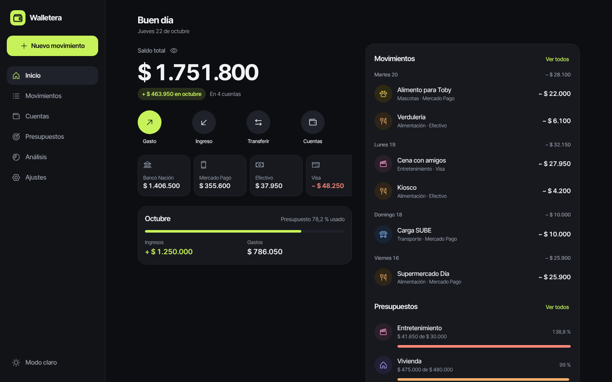
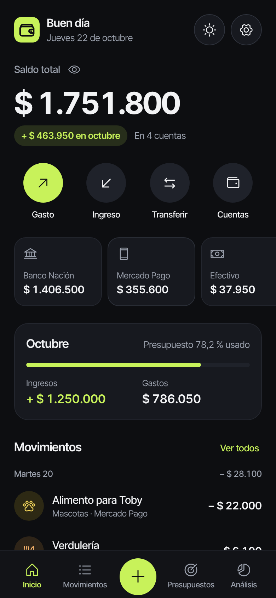
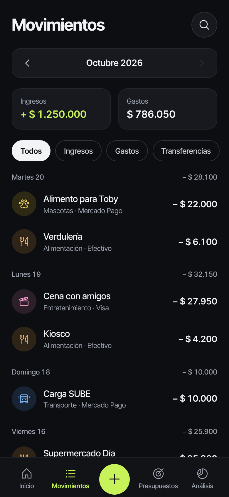
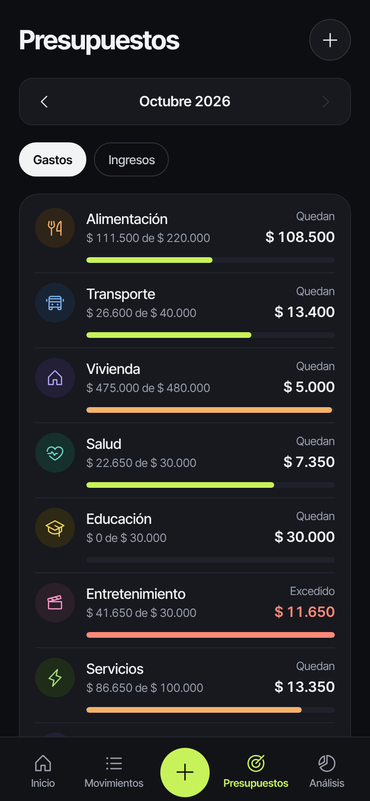
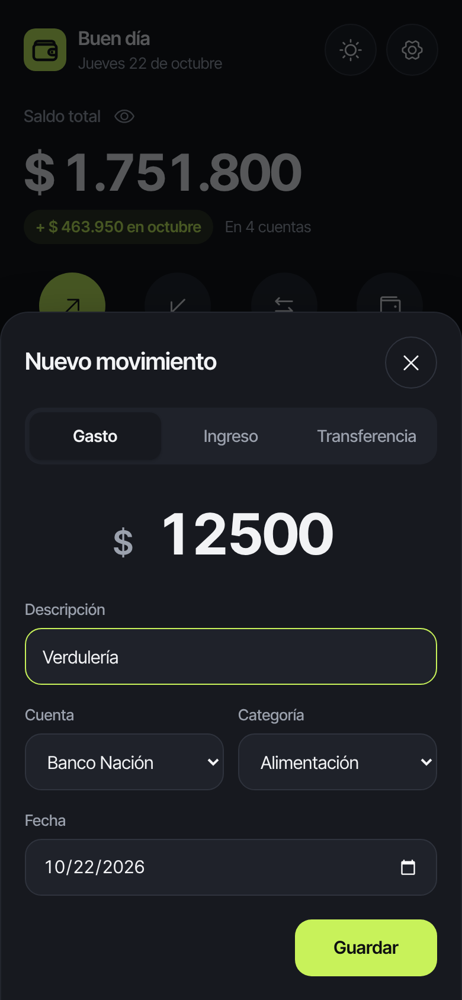
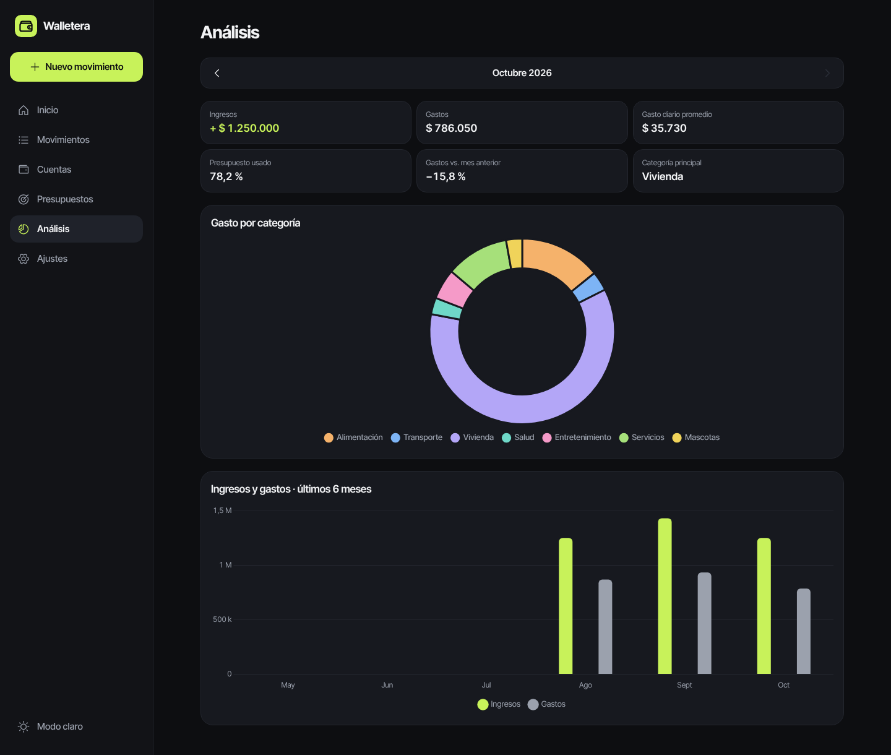
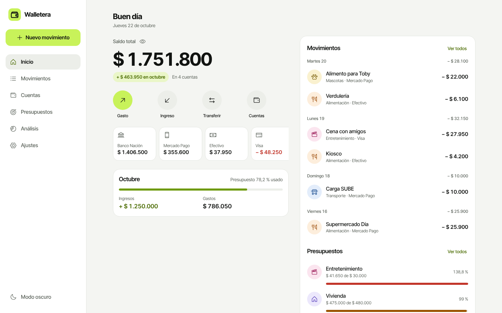

# Walletera

Billetera personal para ordenar tu plata: cuentas, transferencias, presupuestos por categoría y un análisis mensual de ingresos y gastos. Funciona en el navegador, sin registro y sin conexión.

**[Probar la demo →](https://mattugonza-prog.github.io/walletera/)** · En Ajustes, "Cargar datos de ejemplo" llena la app con tres meses de movimientos para explorarla.




| Inicio | Movimientos | Presupuestos | Nuevo movimiento |
| --- | --- | --- | --- |
|  |  |  |  |

| Análisis | Modo claro |
| --- | --- |
|  |  |

## Funcionalidades

- **Cuentas**: efectivo, banco, billetera virtual y tarjeta de crédito, cada una con su saldo inicial. El saldo total es la suma de todas.
- **Movimientos**: gastos, ingresos y transferencias entre cuentas (que no cuentan como gasto ni ingreso). Agrupados por día, con búsqueda y filtros.
- **Presupuestos mensuales** por categoría, con lo que queda o lo que se excedió y una barra que cambia de color al acercarse al límite.
- **Categorías** de gasto y de ingreso, con ícono y color a elección.
- **Selector de mes**: todo el resumen, la lista y los gráficos se pueden ver mes a mes.
- **Análisis**: gasto por categoría, ingresos contra gastos de los últimos seis meses, promedio diario y comparación con el mes anterior.
- **Tus datos**: exportación a CSV (listo para Excel en español), respaldo y restauración en JSON, datos de ejemplo y borrado completo.
- **Modo oscuro y claro**, y un botón para ocultar los montos en lugares públicos.
- **Instalable como app (PWA)** y usable sin conexión.

## Decisiones técnicas

- **JavaScript sin frameworks ni paso de build.** Módulos ES nativos, separados en una capa de datos (`js/datos.js`), sin acceso al DOM y testeable, y una capa de presentación (`main.js`). Se publica tal cual en GitHub Pages.
- **Persistencia en LocalStorage con migraciones versionadas.** Cada cambio de esquema tiene su paso (v1 → v5). Los datos viejos se validan y se convierten en vez de borrarse, y antes de migrar se guarda un respaldo.
- **Fechas sin zona horaria.** Se guardan como `AAAA-MM-DD`, lo que evita que un movimiento cargado en Argentina (UTC−3) aparezca el día anterior. La migración corrige los datos que se habían guardado con ese error.
- **Seguridad básica.** Todo texto del usuario se escapa antes de insertarse en el HTML. El CSV neutraliza fórmulas (`=`, `+`, `-`, `@`) y un respaldo importado se valida registro por registro.
- **Diseño propio.** Variables CSS para los dos temas, cifras tabulares, signo menos tipográfico, foco visible y soporte de `prefers-reduced-motion`. Los diálogos y avisos son componentes propios, accesibles con teclado.
- **Pocas dependencias.** Solo Chart.js (CDN con versión fija) y los íconos de [Phosphor](https://phosphoricons.com), que vienen incluidos en `vendor/`.

## Estructura

```
├── index.html            # Estructura de la app
├── main.js               # Presentación: render, eventos, modales, gráficos
├── js/
│   ├── datos.js          # Estado, persistencia, migraciones y cálculos
│   └── ejemplo.js        # Generador determinista de datos de ejemplo
├── css/estilos.css       # Sistema de diseño (tokens, temas, componentes)
├── sw.js                 # Service worker (uso sin conexión)
├── manifest.webmanifest  # Instalación como app
├── categorias.json       # Categorías iniciales
├── iconos.json           # Catálogo de íconos para categorías
├── tests/                # Tests de la capa de datos (Vitest)
└── vendor/phosphor/      # Fuente de íconos
```

## Cómo correrlo

Necesita un servidor estático, porque los módulos ES y el service worker no funcionan abriendo el archivo directamente.

```bash
npm install
npm start          # http://localhost:5173
```

También sirve cualquier otro servidor estático, como la extensión Live Server de VS Code o `python3 -m http.server`.

## Tests y calidad

```bash
npm test           # Vitest: saldos, períodos, migraciones, respaldo, CSV, datos de ejemplo
npm run lint       # ESLint
```

Los tests corren con la zona horaria de Buenos Aires para cubrir los casos de fechas. GitHub Actions ejecuta lint y tests en cada push y pull request.

## Publicación

El workflow `.github/workflows/ci.yml` publica la app en GitHub Pages en cada push a `main`. Para activarlo por primera vez: **Settings → Pages → Build and deployment → Source: GitHub Actions**.

## Origen

Walletera nació como proyecto final de un curso de JavaScript, un simulador de control de gastos con fondo mensual. Después se rehízo en cuatro etapas:

1. Corrección de errores y base del código.
2. Modelo de billetera con cuentas y transferencias.
3. Rediseño completo.
4. Tests, PWA, datos de ejemplo y publicación.
