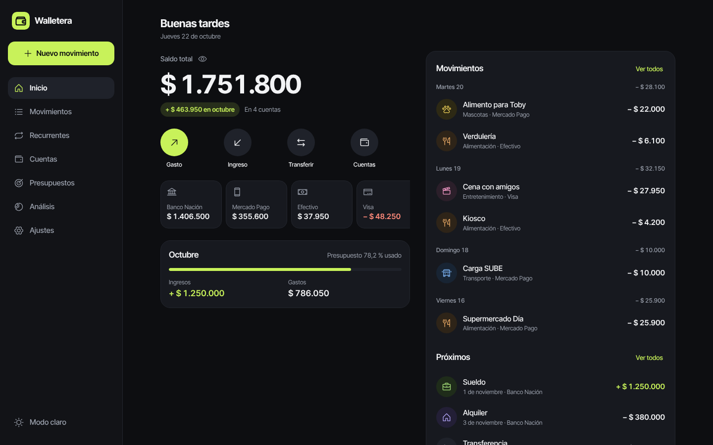
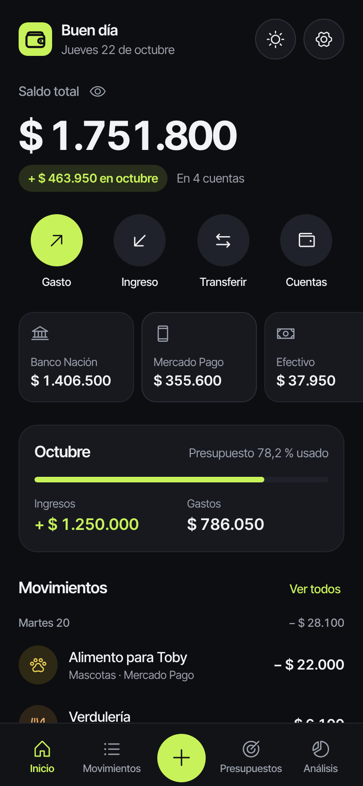
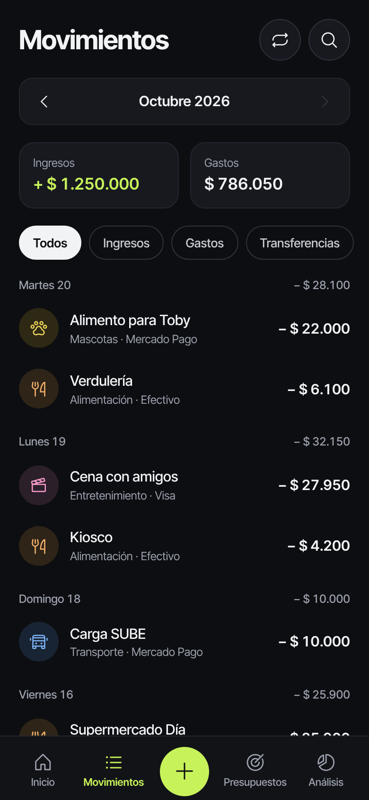
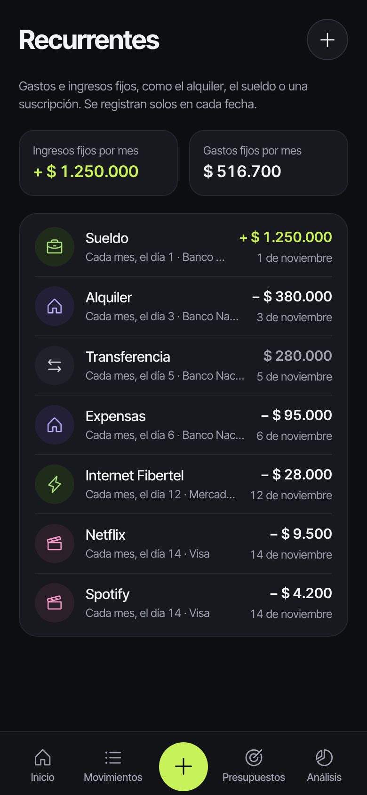
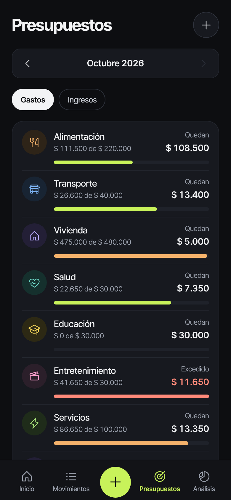
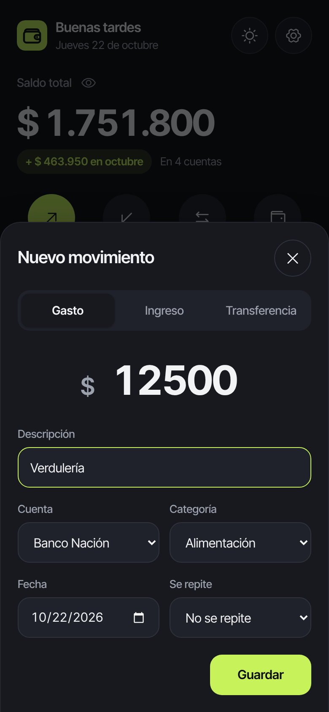
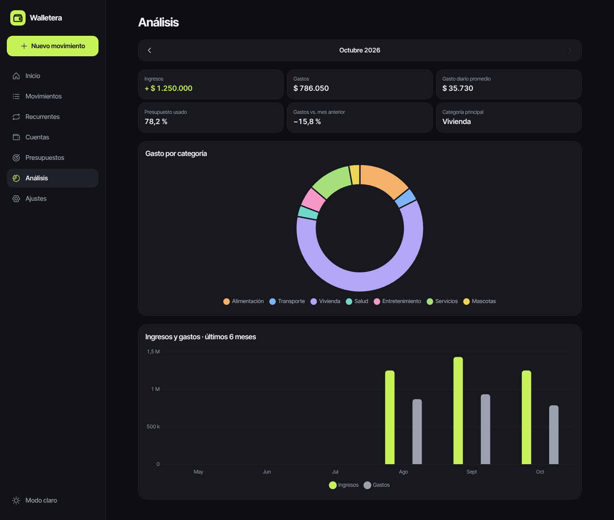
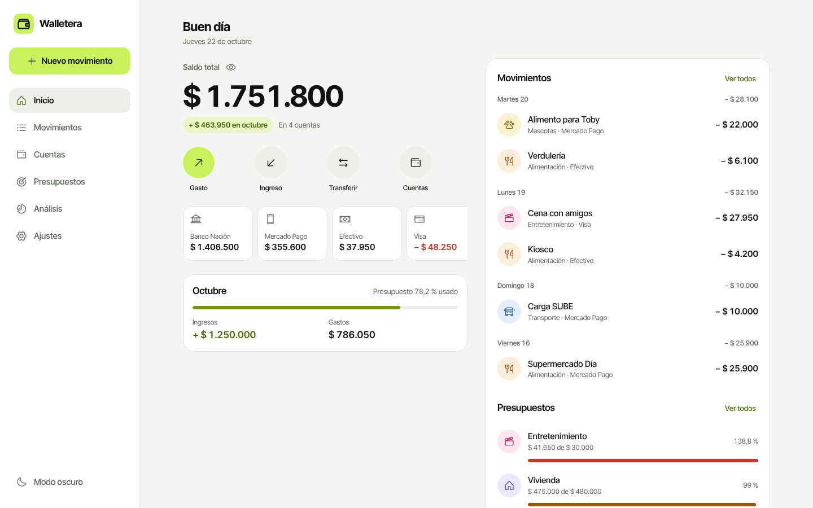

# Walletera

Billetera para ordenar la plata de la casa: cuentas, transferencias, presupuestos por categoría y un análisis mensual de ingresos y gastos. Se usa de dos formas:

- **Sin cuenta**: todo queda en el navegador, como una demo que funciona sin registro y sin conexión.
- **Con el usuario de la casa**: los datos viven en la nube y se ven y cargan desde cualquier dispositivo donde se ingrese con el mismo email y contraseña.

**[Probar la demo → walletera.vercel.app](https://walletera.vercel.app/)** · Para explorarla sin cargar nada a mano: en Ajustes, "Cargar datos de ejemplo" llena la app con tres meses de movimientos.




| Inicio | Movimientos | Recurrentes | Presupuestos | Nuevo movimiento |
| --- | --- | --- | --- | --- |
|  |  |  |  |  |

| Análisis | Modo claro |
| --- | --- |
|  |  |

## Funcionalidades

- **Cuentas**: efectivo, banco, billetera virtual y tarjeta de crédito, cada una con su saldo inicial. El saldo total es la suma de todas.
- **Movimientos**: gastos, ingresos y transferencias entre cuentas (que no cuentan como gasto ni ingreso). Agrupados por día, con búsqueda y filtros.
- **Entre dos fechas**: además de mes a mes, la lista de movimientos se puede ver para cualquier rango ("Desde" y "Hasta", con atajos como "Últimos 3 meses").
- **Descarga en Excel y PDF** de lo que se ve en pantalla (rango, tipo y búsqueda):
  - el Excel trae fechas y montos como valores reales, para ordenar y sumar, y una hoja de resumen con el gasto por categoría;
  - el Excel y el CSV terminan con el ID de cada movimiento (no cambia al editarlo), para quitar duplicados al juntar descargas en una planilla;
  - el PDF es un reporte A4 listo para imprimir.
- **Recurrentes**: alquiler, sueldo, suscripciones. Se registran solos cada mes o cada semana, incluso los que vencieron mientras la app estaba cerrada, y en Inicio aparecen los próximos vencimientos.
- **Presupuestos mensuales** por categoría, con lo que queda o lo que se excedió. Cambiar un presupuesto (por ejemplo, por inflación) rige desde ese mes: los meses anteriores conservan el suyo.
- **Categorías** de gasto y de ingreso, con ícono y color a elección.
- **Análisis**: gasto por categoría, ingresos contra gastos de los últimos seis meses, promedio diario y comparación con el mes anterior.
- **Usuario de la casa**: un solo usuario para todos. Cada dispositivo tiene su sesión; se puede cerrar la sesión en todos a la vez si se pierde un celular. Al volver a la app se ven los cambios del otro dispositivo. Sin conexión se ven los últimos datos guardados.
- **Tus datos**: exportación a CSV, respaldo y restauración en JSON (también para pasar datos del navegador a la nube) y borrado completo.
- **Modo oscuro y claro**, un botón para ocultar los montos en lugares públicos, e **instalable como app (PWA)**.

## Arquitectura

```
Navegador (PWA) ── sin cuenta: localStorage
     │ con usuario: fetch /api/* con cookie de sesión (mismo origen)
     ▼
Vercel: sitio estático (dist/) + función api/index.js (Node + Hono)
     ▼
PostgreSQL (Neon): usuarios, sesiones, cuentas, categorías, presupuestos, movimientos, recurrentes
```

Los cálculos (saldos, resúmenes, gráficos, búsqueda) se hacen en el navegador sobre los datos cargados. El servidor guarda, valida con las mismas reglas que el navegador (`js/dominio.js`), separa los datos de cada usuario y registra los recurrentes. Detalle del modelo, la API y las decisiones de seguridad en **[docs/backend.md](docs/backend.md)**.

## Decisiones técnicas

- **JavaScript sin frameworks en el navegador.** Módulos ES nativos y sin paso de build: capa de datos (`js/datos.js`) sin DOM y testeable, y capa de presentación (`main.js`). Las reglas del dominio (`js/dominio.js`) son puras y las usan el navegador y el servidor.
- **Backend chico y estándar.** API REST en [Hono](https://hono.dev) con SQL parametrizado sobre `pg`, sin ORM. Migraciones en SQL versionadas.
- **Datos que no se pierden ni se cruzan.**
  - Montos en `NUMERIC(14,2)` y sumas redondeadas a centavos.
  - Claves primarias y foráneas que incluyen al usuario.
  - Recurrentes sin duplicados aunque dos dispositivos abran la app a la vez.
- **Fechas sin zona horaria.** Se guardan como `AAAA-MM-DD` (también en Postgres, como `DATE` que nunca pasa por `Date`), así un movimiento cargado en Argentina no aparece el día anterior.
- **Seguridad.**
  - Contraseñas con scrypt y sesión en cookie `HttpOnly` y `SameSite=Lax`.
  - Límite de intentos de ingreso y control de origen contra CSRF.
  - Content Security Policy sin scripts en línea ni `eval`.
  - Todo texto se escapa antes de ir al HTML y el CSV neutraliza fórmulas.
- **Pocas dependencias.**
  - Navegador: Chart.js (CDN, versión fija), los íconos de [Phosphor](https://phosphoricons.com) y, solo al descargar, las librerías de Excel y PDF. Todas, menos Chart.js, están incluidas en `vendor/`.
  - Servidor: `hono`, `@hono/node-server` y `pg`.

## Estructura

```
├── index.html               # Estructura de la app
├── main.js                  # Presentación: render, eventos, modales, gráficos, acceso
├── js/
│   ├── dominio.js           # Reglas puras compartidas con el servidor (fechas, recurrentes, validación)
│   ├── datos.js             # Estado, persistencia (local o nube), migraciones y cálculos
│   ├── api.js               # Cliente de la API
│   ├── exportar.js          # Descargas en Excel y PDF
│   ├── ejemplo.js           # Generador determinista de datos de ejemplo
│   └── tema.js              # Tema antes del primer pintado
├── css/estilos.css          # Sistema de diseño (tokens, temas, componentes)
├── sw.js                    # Service worker (uso sin conexión; nunca cachea /api)
├── api/index.js             # Función de Vercel: entrada de la API
├── servidor/
│   ├── app.js               # La API (Hono): límites, origen, rutas, errores
│   ├── rutas/               # Sesión y datos
│   ├── seguridad.js         # Contraseñas, sesiones, cookie, CSRF
│   ├── repositorio.js       # SQL de los datos
│   ├── recurrentes.js       # Registro de recurrentes en el servidor
│   ├── migraciones/         # Esquema en SQL
│   ├── cabeceras.js         # Encabezados de seguridad (CSP)
│   └── local.js             # Servidor de desarrollo
├── scripts/                 # build, migraciones y cambio de contraseña
├── tests/                   # Vitest: navegador, dominio, exportación y API contra Postgres
└── vendor/                  # Íconos y librerías de Excel y PDF (ver vendor/README.md)
```

## Cómo correrlo

Necesita Node.js 24, la misma versión que usa Vercel.

```bash
npm install
npm start          # http://localhost:5173
```

Sin base de datos la app funciona en modo local (sin cuenta), igual que la demo. Para probar el modo nube:

```bash
cp .env.example .env               # y completá CODIGO_REGISTRO
docker compose up -d               # Postgres local (o usá una rama de desarrollo de Neon en DATABASE_URL)
npm run db:migrar
npm start                          # Ajustes → Iniciar sesión → Crear usuario
```

## Tests y calidad

```bash
npm test           # Vitest
npm run lint       # ESLint
```

- **Navegador**: saldos, períodos, rangos, recurrentes, migraciones, respaldo, CSV, Excel y PDF, modo nube.
- **API**: sesión, aislamiento entre usuarios, validaciones, recurrentes, respaldo y CSRF, contra un PostgreSQL real.
  - Necesitan `DATABASE_URL_TEST` (en `.env` o en el entorno) apuntando a una base cuyo nombre incluya "test", porque se vacía en cada corrida.
  - Si no está definida, se saltean.
  - Con Docker: `docker compose exec db createdb -U walletera walletera_test`.

Los tests corren con la zona horaria de Buenos Aires para cubrir los casos de fechas. GitHub Actions ejecuta lint, tests (con un Postgres de servicio) y build en cada push y pull request.

## Publicación (Vercel + Neon)

1. **Proyecto**: en Vercel, **Add New → Project → importar `mattugonza-prog/walletera`**. `vercel.json` ya define el build, la función de la API, las reglas de ruteo y los encabezados.
2. **Base de datos**: en el proyecto, **Storage → Create Database → Neon** (el plan gratis alcanza). Conectala a **Production**: eso crea `DATABASE_URL`. En el primer deploy de producción el build aplica las migraciones.
3. **Registro**: en **Settings → Environment Variables**, agregá `CODIGO_REGISTRO` (Production) con un código largo que solo sepas vos, y volvé a desplegar.
4. **Tu usuario**: en la app, **Ajustes → Iniciar sesión → Crear usuario** con tu email, una contraseña y ese código. Si en ese navegador ya tenías datos, la app ofrece subirlos.
5. **Cerrar el registro**: borrá `CODIGO_REGISTRO` y volvé a desplegar.
6. **Los demás dispositivos**: Ajustes → Iniciar sesión, con el mismo email y contraseña.

Los previews de cada pull request funcionan sin cuenta si no tienen base configurada (la API responde 503 y la app queda en modo local).

**Opcional, más rápido desde Argentina**: creá la base en São Paulo (`aws-sa-east-1`) y agregá `"regions": ["gru1"]` en `vercel.json`. La función y la base tienen que estar en la misma región: si no, cada consulta cruza el continente.

**Si nadie recuerda la contraseña**: con `DATABASE_URL` de producción en `.env`, `npm run clave -- tu@email.com` pide una nueva y cierra todas las sesiones.

## Origen

Walletera nació como proyecto final de un curso de JavaScript, un simulador de control de gastos con fondo mensual. Después se rehízo en etapas:

1. Corrección de errores y base del código.
2. Modelo de billetera con cuentas y transferencias.
3. Rediseño completo.
4. Tests, PWA, datos de ejemplo y publicación.
5. Movimientos recurrentes.
6. Backend con usuario de la casa, presupuesto por mes, rango de fechas y descargas en Excel y PDF.
